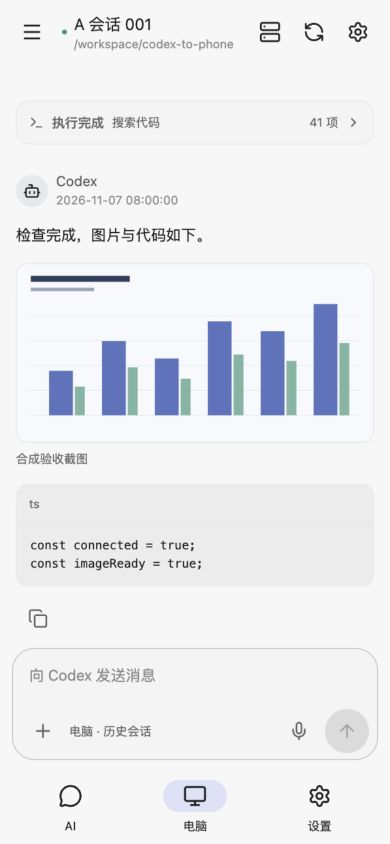
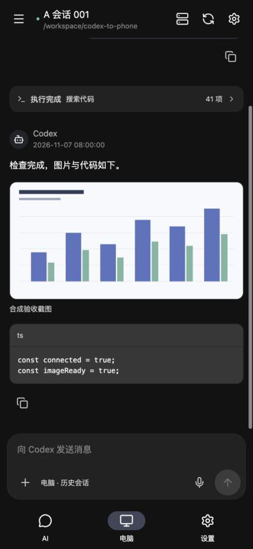
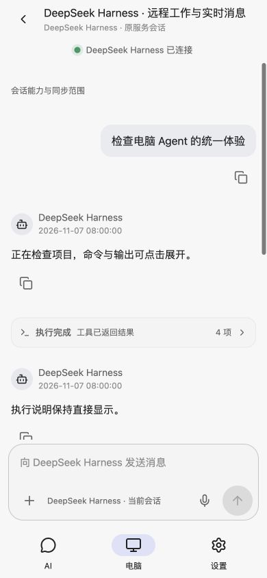
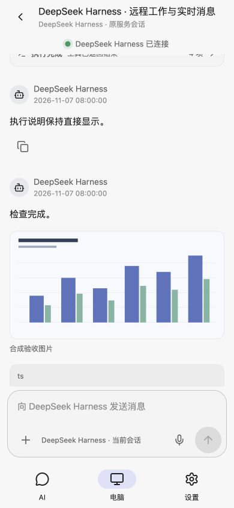

<div align="center">

# MobiCodex


**AI 聊天 · Codex 电脑工作台 · 一个 App**

[](#下载)
[](releases/android/kelivo-preview/0.1.9/)
[](apps/kelivo)
[](apps/kelivo/LICENSE)

[下载](#下载) · [界面预览](#界面预览) · [开始使用](#开始使用) · [开发与构建](#开发与构建) · [验证记录](docs/audits/2026-11-07/mobicodex-branding.md)

</div>

MobiCodex 把 Kelivo 的 AI 客户端与 Codex To Phone 的电脑控制能力放进同一个 Android App，统一使用 Kelivo 的配色、导航和聊天风格。

你可以在「AI」页独立聊天，也可以在「电脑」页继续电脑上的 Codex、DeepSeek Harness、Claude Code 或 OpenCode 会话。需要衔接时，主动将某条 AI 回复交给电脑，编辑并确认发送。切换入口无需调用模型判断，也不会自动创建电脑任务。

当前交付为 **0.1.9-native-preview / versionCode 11**，面向 Android arm64 手机。源码保留不等于所有功能都完成验收；完整 Kelivo 功能对照、最低系统、系统插件与部分真实联动仍在逐项检查，详见[验收账本](docs/audits/2026-11-06/kelivo-parity-evidence.md)。

2026-11-07，用户已真机确认升级 code9，DeepSeek 原会话和正文正常。配套网关及 DeepSeek 0.2.7 原桥接已上线，兼容实际宿主 0.2.2-rc.1；本地/公网 77 项检查通过。code8 说明常显与 code7 图片/大图、字号、连接/草稿/主题的真机证据保留；code9 其余真实交互仍按项验收，详见[运行记录](docs/audits/2026-11-07/agent-parity-runtime.md)。

code10 使用用户选定的黑白电脑/手机图标，并将应用名、启动画面、通知、关于及更新入口统一为 MobiCodex。保留旧包名、签名与数据兼容标识，直接覆盖升级；图标及 Flutter 原生资源通过 APK 更新。原始开源归属继续保留，详见[品牌交付记录](docs/audits/2026-11-07/mobicodex-branding.md)。

## 下载

| 文件 | 用途 |
| --- | --- |
| [Android APK：0.1.9 预览版（下载页）](https://zyzlz.xin/mobile-codex/releases/android/kelivo-preview/index.html) | Android 7.0+、arm64-v8a；原预览证书签名，可覆盖安装已有版本 |
| [GitHub Release APK](https://github.com/luoz76070-art/MobiCodex/releases/download/mobicodex-kelivo-v0.1.9-native-preview/mobicodex-0.1.9-preview-arm64.apk) | 同一次构建，GitHub Actions 临时证书签名，仅适合全新安装或核对构建 |
| [对应源码归档](https://github.com/luoz76070-art/MobiCodex/releases/download/mobicodex-kelivo-v0.1.9-native-preview/mobicodex-0.1.9-preview-source.tar.gz) | 与本 APK 对应的源码、依赖锁、构建入口和逐文件 SHA256 |
| [电脑网关图片修复预览](releases/android/kelivo-preview/0.1.7/desktop-image-reference-preview/) | 支持原会话明确引用的隔离副本图片，沿用 code9 与 DeepSeek 0.2.7；[检查与部署状态](docs/audits/2026-11-07/image-reference-fix.md) |
| [最新电脑兼容补充：DeepSeek 0.2.7](releases/android/kelivo-preview/0.1.7/desktop-0.2.7-preview/) | 配套网关、原 profile 桥接、源码补丁；新增 Harness 0.2.2-rc.1 兼容，无个人配置 |
| [code9 原配套网关与插件](releases/android/kelivo-preview/0.1.7/README.md#电脑端配套更新) | 原归档保留，含 Claude 0.1.2；DeepSeek 新宿主请用上面的 0.2.7 补充 |
| [校验值与版本说明](releases/android/kelivo-preview/0.1.9/) | SHA256、签名说明、兼容边界及电脑网关要求 |

安装包约 59.8 MiB，包名为 `com.mobilecodex.kelivo.preview`。下载页与 App 内更新提供的安装包使用原预览证书签名，可直接覆盖安装；GitHub Release 上的同版本安装包由 GitHub Actions 构建并用临时证书签名，不能覆盖已安装版本。它与原独立 Codex To Phone App 的包名不同；手机安装器会要求你确认。

App 的独立自托管更新源已同步 **0.1.9 / code11**。code6–10 使用者可打开「设置 → 应用更新 → 检查更新」，下载后按 Android 提示确认安装。code4/5 请先用上面的 APK 覆盖安装一次。更新包与对应源码的公网校验见[发布记录](docs/audits/2026-11-07/mobicodex-branding.md)；电脑网关升级另按版本说明操作。

## 界面预览

<p align="center">
  
  
</p>

<p align="center">
  
  
</p>

新增两图为code9 DeepSeek隔离浏览器的合成数据，展示各Agent共用组件的实际效果。

以上是 code7 前端在隔离浏览器中的图片/紧凑字号示例，使用合成会话与图片。code8 进一步让执行说明常显，code9 将相同展示与输入能力接到所有电脑 Agent；截图不包含个人项目或模型任务。

## 功能

| 入口 | 能做什么 |
| --- | --- |
| AI | 复用 Kelivo 的模型配置、多供应商聊天、Markdown、工具、MCP、工作区和备份等源码；无需连接电脑即可使用 |
| 电脑 | 按项目查看会话，跟随输出，发送文字与附件，处理已适配的问答、审批、排队和停止操作 |
| 可选交接 | 从 AI 回复准备一张任务卡，自选电脑已有会话，编辑后确认发送；不自动转发整段历史 |
| 统一设置 | 主题、聊天字号与工具显示偏好；独立的 APK 更新入口 |

本次电脑页改进（所有通道共用）：

- 执行说明和记录按顺序直接显示；连续工具调用合并为动态摘要，默认只收起命令/输出，点击一次查看明细，最终回复单独显示。
- 默认正文 15px、代码 12px、工具输出约 11px；长输出在块内滚动，聊天字号跟随 Kelivo 偏好。
- Markdown 图片直接显示，点击查看大图，可切换原尺寸并重试加载。
- Codex 与各 Agent 共用输入框、附件、语音、独立草稿和运行中操作；按钮以原通道能力为准，Claude 保持只支持排队。
- DeepSeek 原生/PTC、Claude 原工具和 OpenCode 混合消息投影命令与可见输出；推理和私有内部结果不进入手机展示。
- 后续通道实现标准 SessionAdapter 并登记能力后直接复用这一套界面，无需复制页面。
- 本地图片经过电脑网关鉴权，支持当前会话项目目录内的 PNG、JPEG、GIF、WebP、AVIF，以及同一会话助手 Markdown 明确引用的项目外精确图片，单图不超过 8 MiB。HTTPS 图片也可显示。

本地图片需要 **本版本配套网关**；旧网关会显示升级提示。Codex、DeepSeek Harness、Claude Code、OpenCode 及注册 SessionAdapter 的后续通道均共用取图接口；后三类需要已连接的原会话订阅。只有路径、没有 Markdown 图片引用的文本不会自动变成图片。

## 开始使用

### AI 聊天

安装后进入「AI」，在设置中添加你使用的供应商、地址和模型凭证，再选择模型开始聊天。模型服务由你配置；AI 聊天与电脑连接各自独立。

### 连接电脑

电脑需运行 Codex Desktop 和本项目网关；跨网络访问还需你自己的 HTTPS Broker。网关通过主动连接 Broker 传输消息，手机不需要与电脑处于同一 Wi-Fi。

首次从源码准备：

```sh
git clone https://github.com/luoz76070-art/project.git
cd project
corepack pnpm install --frozen-lockfile
corepack pnpm build:plugin
node dist-plugin/mobile-codex/scripts/mobile-codex.mjs status
node dist-plugin/mobile-codex/scripts/mobile-codex.mjs init --workspace /absolute/path/to/your/project
```

按照[网关配置说明](plugins/mobile-codex/README.md)补全私有 Broker 配置，再执行：

```sh
node dist-plugin/mobile-codex/scripts/mobile-codex.mjs start
node dist-plugin/mobile-codex/scripts/mobile-codex.mjs pair
```

在手机「电脑 → 设置」粘贴一次性配对信息，连接后选择已有会话。`pair` 只生成短期配对信息，不调用模型。已有配置请先 `status`，沿用原配置和工作目录，按[版本包说明](releases/android/kelivo-preview/0.1.7/README.md)切换网关程序。

[Broker 部署](docs/remote-broker.md) · [网关管理](plugins/mobile-codex/README.md) · [其他 Agent 接入](docs/agent-gateway.md)

## 开发与构建

| 目录 | 职责 |
| --- | --- |
| `apps/kelivo` | 固定上游 Kelivo v1.3.4、Flutter AI 与统一宿主 |
| `apps/mobile` | React / Capacitor 电脑工作台，保留原独立 App 入口 |
| `apps/relay` | Fastify API、Codex Desktop IPC、Broker 与 Tunnel |
| `integrations/kelivo` | 来源清单、宿主桥接、Android 组合与构建契约 |
| `plugins` | 电脑网关及其他 Agent 的接入包 |
| `releases/android/kelivo-preview` | 用户明确要求入库的版本化 APK、源码和校验信息 |

Node.js 22+、pnpm 10.20.0。原生构建使用固定 Flutter 3.47.6、Android SDK 36、NDK 28.2、JDK 17 与 JDK 21+；完整路径和镜像设置见[原生构建说明](integrations/kelivo/README.md)。

```sh
corepack pnpm install --frozen-lockfile
corepack pnpm verify
node scripts/verify-kelivo.mjs --preview --repeat-tests
```

APK 输出：`output/kelivo/mobile-codex-kelivo-0.1.8-preview-arm64.apk`。发布目录包含构建元数据及对应源码；缓存、签名私钥、模型凭证和个人数据不入库。自己的构建签名与这里的预览证书不同，不能据此承诺覆盖安装或字节完全相同。

code10 完整 JS/TS verify（手机169/后端422）、最终Dart分析与相关Flutter回归、原生340项和完整Android lint通过；宿主/远控66/1条警告已记录，签名与code9相同。新图标、启动资源、更新页与源码归档已核验；2026-11-07用户已真机确认「已升级，图标名称与原配置都正常」，安装APK/SHA未独立回拉。详见[品牌审计](docs/audits/2026-11-07/mobicodex-branding.md)。

历史 code9 完整 JS/TS verify（手机169/后端414/入口8）、原生340项及完整 Android lint 通过；宿主/远控保留56/1条既有警告。浏览器四通道、未来通道夹具、图片/附件/语音与窄屏大字号已检查；Claude 官方2.1.287严格校验和8项沙箱测试通过。后续 0.2.7 电脑兼容补充的后端419项、新旧官方运行时各30项、类型/lint及构建全部通过，已上线并获用户手机code9原会话/正文确认；其余真实控制、Claude/OpenCode原宿主仍待验。未修改或重打手机APK，沿用原生验证，详见[code9记录](docs/audits/2026-11-07/agent-parity.md)与[运行审计](docs/audits/2026-11-07/agent-parity-runtime.md)。

## 致谢与许可

AI 部分来自 [Chevey339/Kelivo](https://github.com/Chevey339/kelivo)，固定 v1.3.4 / `4a7da9b6`，保留上游业务、平台源码、测试和依赖。感谢 Kelivo 及其贡献者；MobiCodex 是独立整合预览。

整合 Android 程序按随附 [GNU AGPL v3](apps/kelivo/LICENSE) 发行。原 Codex To Phone 源码保留 [MIT 许可](LICENSE) 与版权声明；对应源码归档分别附上 AGPL、原 MIT 和第三方声明。各依赖沿用其原许可。来源与修改清单见 [integrations/kelivo](integrations/kelivo/README.md) 及源码包内的 `SOURCE-MANIFEST.json`。
