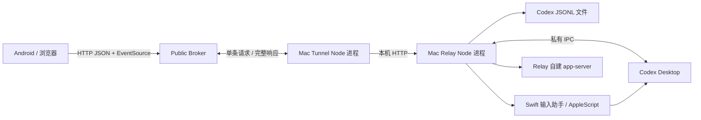
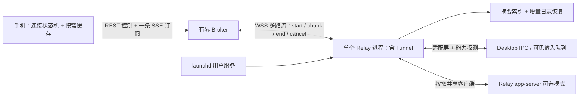

# Codex To Phone 源码、功能与连接体验审核

审核日期：2026-10-20（Asia/Shanghai）。目标：轻量、实时、随时可重新接入；UI 以 Codex 手机版为主要参考。

## 执行进度

已完成 Trellis 布局调整、A–D 本轮源码实施及隔离验证，详见 [执行记录](execution.md) 和 [交付与统一实测](delivery.md)。下文检查表、问题和数字保留为修复前基线；最新源码以 [工程布局](../../project-layout.md) 为准。手机订阅恢复、档案隔离及新版 UI 已实施，真实 Desktop/Android/睡眠恢复/Windows/长期运行尚待验收。

## 结论与边界

当前架构适合继续演进，但连接恢复、流式传输和数据一致性存在确定缺陷。建议保留 React + Capacitor + Node/Fastify，先修复传输与恢复链路，再减少持续资源开销。当前不足以把“公网低延迟、自动恢复、长期常驻”作为已验收能力。

前端构建结果约为 JS 275.66 kB / gzip 87.92 kB、CSS 29.35 kB / gzip 6.18 kB。这说明前端下载体积已有较小基线；应优先处理重复请求、同步存储、全目录扫描和全量快照。该数据不能代表 APK 大小、Android 内存或运行功耗。

本次完成了主运行链路审阅、隔离后端复现、浏览器功能检查、Swift 类型检查和依赖公告扫描。未调用真实 Codex 消息发送、模型 turn 或 UI 注入，未检查或修改线上服务器。Android 真机/模拟器、Windows 全流程、睡眠唤醒和长期功耗仍待验证。本报告不是对每一行生成协议或所有历史脚本的逐行背书。

工作区原有多项修改。本次新增审核材料，未修改业务源码，未暂存、提交或部署。

## 当前链路



关键断点：EventSource 需要持续收到响应块，Tunnel 却执行 `await response.text()`，Broker 只接受一条完整 `response`。这条公网路径不能持续转发 SSE。

## 检查结果

| 检查 | 结果 | 说明 |
| --- | --- | --- |
| `corepack pnpm typecheck` | 通过 | Relay 和 Mobile |
| `corepack pnpm test:messages` | 通过 | 现有镜像消息、乐观消息与排序用例 |
| `corepack pnpm test:codex-executable` | 通过 | 可执行文件探测 |
| `corepack pnpm build` | 通过 | TypeScript + Vite 生产构建 |
| 两个 Swift helper 的 `xcrun swiftc -typecheck` | 通过，有警告 | Input 的激活选项存在弃用警告 |
| 隔离 Broker/Tunnel | 复现多项缺陷 | JSON 正常；SSE、断线在途请求、取消传递存在问题 |
| JSONL 边界数据 | 复现两项缺陷 | 初次读取跨半行丢消息；600 KB 单条记录游标卡住 |
| 实际 Relay SSE + 模拟 DesktopControl | 复现跨域缺陷 | 普通 API 有 CORS，SSE 无 CORS |
| 浏览器 360×800、430×932 | 基础展示通过 | 未见横向溢出；设置可打开/关闭；消息可显示 |
| 浏览器连接档案与断流检查 | 失败 | 切档案仍轮询旧连接；流错误后未重连 |
| `corepack pnpm audit --prod --json` | 失败，退出码 1 | 68 条依赖公告：2 critical、48 high、15 moderate、3 low |

依赖计数不等于 68 个可从公网利用的漏洞。Mobile 把 CLI、Vite、TypeScript、React 插件放在 `dependencies`，因此 `--prod` 也包含构建工具及其传递依赖。应逐项区分服务端运行时、APK 原生运行时和构建期暴露。

## 按优先级排序的问题

P1：直接影响核心目标，或需在下一次发布前修复。P2：影响长期稳定性、资源或功能完整性。P3：维护与兼容性改进。

| ID | 优先级 | 发现 | 主要证据 |
| --- | --- | --- | --- |
| F01 | P1 | 公网隧道缓冲整个响应，无法转发 SSE | `remoteTunnelClient.ts:92-109`；`brokerServer.ts:71-81`；隔离实测 |
| F02 | P1 | Relay 的 SSE 绕过普通 CORS 响应头 | `server.ts:156-162,280-286`；实际 Relay 实测 |
| F03 | P1 | 隧道缺少主动心跳与死亡连接检测，在途请求不随断线结束 | `remoteTunnelClient.ts:47-68`；`brokerServer.ts:118-159`；隔离实测 |
| F04 | P1 | 手机事件流错误后被永久关闭，缺少恢复与令牌重取 | `main.tsx:1453-1496,1498-1571`；浏览器实测 |
| F05 | P1 | 切换档案仍运行旧 Endpoint/Token 的轮询，缓存未按连接隔离 | `main.tsx:827-835,1418-1451,2849-2885`；浏览器实测 |
| F06 | P1 | 初次读取游标越过未完成 JSONL 末行，补完后消息丢失 | `codexStore.ts:128-146,334-357`；隔离实测 |
| F07 | P1 | 单条 JSONL 超过 512 KB 时 delta 永远不前进 | `codexStore.ts:150-178`；600 KB 合成记录实测 |
| F08 | P1 | 热更新版本名接受 `.`、`..`，可使删除目标落到根目录或父目录 | `HotUpdatePlugin.java:180-183,205-207`；正则与路径求值 |
| F09 | P1 | 长连接客户端初始化竞态，连接失效后仍复用旧对象 | `liveTurnController.ts:290-307`；初始化竞态隔离实测 |
| F10 | P1 | macOS 输入通道无服务端串行队列；超时后降级可能重复提交 | `macosUiInjector.ts:54-104`；`MobileCodexInput.swift:5-7,118-144`；静态审阅 |
| F11 | P1 | 已安装运行时依赖命中公开安全公告 | Android 7.4.4、ws 8.20.0、Fastify 5.6.2；依赖扫描与维护者公告 |
| F12 | P2 | 快速轮询始终与 SSE 并行，空闲仍持续请求 | `main.tsx:290-295,1418-1496`；浏览器请求计数 |
| F13 | P2 | 查线程摘要会读取完整历史，线程列表热路径全目录扫描 | `desktopControl.ts:251-263`；`codexStore.ts:56-95,102-122,236-278`；合成数据计数 |
| F14 | P2 | 每次线程状态变化都同步序列化并写整个聊天缓存 | `main.tsx:1394-1396,2870-2885`；静态审阅 |
| F15 | P2 | 完成 turn、Desktop 状态 Map 无淘汰；推送反复携带完整历史 | `liveTurnController.ts:186-199,476-537`；`desktopControl.ts:55-57,323-330` |
| F16 | P2 | 任意 assistant 文本就被判定 turn 完成 | `main.tsx:1277-1286`；`codexStore.ts:424-425`；静态审阅 |
| F17 | P2 | 首次历史固定 24 条 / 64 KB，无更早历史分页入口 | `main.tsx:288-289,2512-2519,3352-3354`；`server.ts:319-323` |
| F18 | P2 | Mac 进程退出只更新标签；缺少自动重启、唤醒恢复与真实在线状态 | `MobileCodexRelay.swift:155-162,249-260,316-320` |
| F19 | P2 | 请求取消、流背压、并发与缓冲上限缺失 | `brokerServer.ts:128-159`；`remoteTunnelClient.ts:70-114`；取消隔离实测 |
| F20 | P2 | 更新清单直接覆盖、热更新确认过早、旧 bundle 无保留上限 | `publish-android-update.sh:68-71`；`publish-hot-update.sh:62-65`；`main.tsx:1640-1644`；原生更新存储 |
| F21 | P2 | 桌面控制错误可能退到另一个 app-server，提交缺少幂等标识 | `main.tsx:962-978,1036-1048,3214-3225`；发送 API schema |
| F22 | P2 | 健康检查把可达性当作鉴权与可控性；macOS 状态乐观 | `main.tsx:1605-1633`；`server.ts:41-44`；`desktopControl.ts:81-94` |
| F23 | P2 | URL 短令牌进入默认请求日志；长期 Token 明文存储且允许明文 HTTP | `server.ts:21,258-264`；`remoteTunnelClient.ts:130`；`docs/remote-broker.md:66-76`；Android Manifest |
| F24 | P2 | 私有 IPC 的 JSON 解析异常可逃逸数据处理器 | `desktopIpcClient.ts:223-241`；合成非法帧实测 |
| F25 | P3 | 重复服务入口与前端单文件增加维护风险，工具依赖归类不准确 | `server.ts` / `serverExe.ts`；3438 行 `main.tsx`；Mobile package.json |

### F01–F02：先让流真正贯通

隔离 HTTP 服务立即输出 SSE 帧，直连能马上读取；同一路径经过实际 Broker/Tunnel 后，在测试设置的 1200 ms 截止时返回 HTTP 502。生产默认超时是 180000 ms。该结果与 Token、Codex 响应速度无关。

局域网路径也有独立问题：对真实编译后的 Relay 发起请求，并把 DesktopControl 替换为合成对象。普通 stream-token API 返回 `Access-Control-Allow-Origin: https://localhost`；SSE API 返回 200 和数据，但该跨域头为 null。EventSource 与 CapacitorHttp 使用不同网络入口，普通 JSON API 成功不能证明 EventSource 可用。

改法：在既有 WSS 隧道增加 `response-start`、`response-chunk`、`response-end`、`cancel`，Broker 收到头和块就向 HTTP 客户端写出。保留同一套 REST + SSE 对手机暴露，避免同时引入第二套手机 WebSocket 协议。Relay 使用 Fastify 支持的流式响应机制，统一鉴权/CORS；测试 Fastify 生命周期、取消和背压。

### F03–F04：恢复必须覆盖整条连接

WebSocket 存在自动应答机制并不等于应用会主动探测断链。目前两端都没有主动 ping/pong 超时检测，`lastSeenAt` 也没有用于失活判断。Wi-Fi 切换、电脑休眠或网络黑洞可能保留一个表面 OPEN 的连接。

Broker 的 pending 只有 requestId，没有所属 Relay/连接代次。关闭 Relay 只移除 relays，未拒绝该连接的在途请求。测试中 Relay 断开后请求仍等待 1800 ms 的测试超时，最终返回 500；源码生产默认是 180 秒。另一个防御缺口是回包未校验 Relay 所属：合成第二个 Relay 在被测试脚本告知 requestId 后可以完成第一个 Relay 的请求。UUID 未被证明可猜测，因此此项是隔离加固建议，不是已证实的跨租户入侵路径。

手机 `onerror` 主动 `close()`，取消了 EventSource 自带重连，又没有自行安排重连。流 token 15 分钟过期，源码未见重新取 token 的恢复机制。建议增加全抖动指数退避、握手截止时间、心跳超时终止、网络恢复触发和新 token 获取，并让断链在途请求立即得到结构化 503。

### F05：档案切换需要取消旧会话

浏览器测试先连接 A，再选 B：本地 activeProfileId 已是 B，但标题仍是 A；A 的 delta 请求从 70 次增加到 116 次，B 的 delta 为 0。新 SSE 则带着旧 A 线程 ID 向 B 请求。原因是轮询 effect 仅依赖线程 ID 和 watchMode，捕获的旧 endpoint/token 没有更新。

改法：以 profileId + relay 身份建立连接作用域。切换时取消旧请求、定时器与订阅，清空旧选中线程，再加载新连接线程。缓存、草稿、cursor 按连接作用域保存；异步响应携带连接代次，过期响应不得修改当前 UI。连接参数最好有草稿和已应用值，避免编辑设置每个字符都触发网络检查。

### F06–F07：补全日志读取的边界协议

`readThreadLatest` 解析到半行时丢弃解析失败内容，却把 cursor 设置为整个文件大小。补完后的 delta 从行中间开始，仍解析失败，该消息被跳过。测试消息 `must-not-disappear` 在初读与后续 delta 中均消失。

`readThreadDelta` 固定最多读取 512000 字节；如果这段里没有完整换行，就返回原 cursor。600 KB 单行及其后消息会永久堵住该订阅。

改法：cursor 只前进到完整 JSONL 记录的字节边界；长行允许按有界策略继续累积，超过安全上限返回明确 resync 状态，不能无休止地返回相同游标。文件截断/轮换需要返回 generation/reset，客户端替换相应基线。尾部窗口偏移也应按 UTF-8 字节计算，避免把字符串字符位置当作文件字节偏移。

### F08：热更新路径必须做包含关系检查

版本正则 `[A-Za-z0-9._-]+` 接受 `.` 和 `..`，`bundleDir(root, "..")` 指向 root 的父目录。安装过程会先递归删除 target，再 rename staging。若异常或恶意 manifest 使用这些版本名，可删除应用 filesDir 内文件；本次仅做等价正则与路径求值，没有执行删除或原生安装。

改法：版本名必须以字母数字开头、明确拒绝点目录；所有 staging/target canonicalPath 必须严格位于热更新根目录下，并禁止删除 active/previous 目录。SHA-256 校验已有价值；后续可用内置公钥校验 manifest 签名，为发布源失陷增加独立边界。

### F09–F10、F21：发送应有明确确认语义

`ensureClient` 在 start 完成前就设置 this.client。并发第二次调用直接返回这个尚未就绪的对象；隔离测试中第一次还在启动，第二次 status 已报告 ok。断连后客户端引用也未按连接状态重新创建。应先等待同一个 starting promise，确认可用后才发布 client，并在 close/exit 后恢复。

macOS 每个请求都聚焦窗口、等待固定时间并通过共用 `/tmp` 文件与剪贴板发送。手机的 sendLock 只保护当前页面，多个设备/请求可互相覆盖；helper 实际提交但确认超时时，AppleScript 回退可能再次按下 Return。应由服务端单队列处理整个聚焦—输入—验证事务，使用独立请求目录、requestId 和提交状态；状态不明时先核对落盘结果。

当前桌面路由在部分 IPC 错误下退到 Relay app-server，这与工程档案中保持同一个 Desktop 会话的目标存在冲突。建议桌面模式默认报告无法接管；独立 app-server 模式作为明确选择。对非幂等发送引入 clientMessageId、短期去重记录和 received/submitted/confirmed 三阶段状态，避免因超时重试重复执行。

### F11：先处理真实运行时依赖

2026-10-20 安装版本和公告核对：

| 组件 | 已安装 | 已核对修复下限 / 路线 | 暴露分类 |
| --- | --- | --- | --- |
| `@capacitor/android` | 7.4.4 | Android 7.x 公告修复为 7.6.9；core/cli 同步选兼容版本 | APK 原生运行时，critical 公告 |
| `ws` | 8.20.0 | 已列公告修复下限 8.21.0 | Broker/Tunnel 运行时 |
| `fastify` | 5.6.2 | 扫描列出的公告修复下限最高为 5.12.5 | Relay/Broker 运行时；各公告触发条件不同 |
| `tar`、Vite 等 | 见 dependency-audit.json | 升级相容工具链并重扫 | 主要为构建/开发工具，不能全部算作 APK 运行时漏洞 |

Capacitor 的维护者公告指出内部 HTTP 代理路径可让远程内容以应用 origin 加载。项目启用了 CapacitorHttp，且连接凭证位于 WebView localStorage，因此应优先升级原生依赖；热更新 HTML 无法代替重新构建 APK。本次没有针对用户设备执行利用测试。

升级前后分别跑构建、Broker 流转发、跨域、上传、热更新、APK 覆盖安装和真机网络切换。修复下限来自本次公告，不代表“最新版本”。

### F12–F15：轻量化的主要收益点

1. 桌面路径 SSE 成功也不停止轮询。300 ms / 1200 ms 的配置在忽略 RTT 时分别约 12000 / 3000 次请求每小时，实际频率为 `1 / (间隔 + 请求耗时)`。改为推送为主，断流时有界降级轮询；推送正常时仅低频对账。
2. `DesktopControl.getThread` 为得到标题却调用完整历史读取，连 `/api/desktop/active`、发送前路由确认、状态检查都会受影响。先把摘要查询和消息读取拆开，避免每次读全历史。
3. 合成 1000 个小文件、返回 12 个线程：冷读 33 ms，热读 11 ms；热读仍有 1024 次 stat、72 次 open、一次目录遍历。它证明每次请求的工作量随全库增长，未证明当前生产延迟为多少。建议内存索引 + mtime 缓存、文件变化通知 + 低频对账，避免一开始引入数据库或全量文件 watcher。
4. `threadState` 连草稿、状态文字变化都会触发整个缓存同步 stringify/setItem。先把持久化数据和临时 UI 状态分开，再按脏线程在 0.5–2 秒窗口内合并写入；长历史用 IndexedDB，限制总字节数和 LRU。
5. 完成 turn 与 Desktop 的状态 Map 没有 TTL/LRU，`listActiveTurns` 还返回已完成项。为已完成 turn 设置回收策略；重启恢复依赖持久化线程与游标，不能依赖无限内存对象。
6. Desktop 每次 IPC patch 都生成并发送完整消息快照；Live 路径 700 ms 节流仍发送整个快照。用 itemId + delta + seq 作为热路径，初次进入和校验时才发有界快照；terminal 状态不延迟。

### F16–F18：功能口径与随时连接

delta 中任何 assistant 文本都会清除 sending 并把 turn 标成 completed，无法区分中途说明和最终完成。应解析 task/turn 的开始、完成、失败与审批事件，建立独立状态流，文本与运行状态分别更新。

首次桌面消息只取 24 条/64 KB，内存上限 240 条，且没有 beforeCursor 或加载更早历史入口。上拉只能浏览已经缓存在本机的内容。线程列表请求 120 条后只保留 12 条，搜索也只搜索这些项。应补充按需分页与游标查询，保持首屏加载轻量。

Mac App 的 running 仅表示 Relay 进程存在，不能说明 tunnel 在线、Token 正确、Desktop 可控。进程意外退出仅清空引用和更新标签。建议原生 App 保留菜单栏/配置，后台进程由 launchd 的用户级服务管理，增加网络恢复和唤醒检查、日志轮转及分层状态。不能保证电脑关机、深度睡眠或断网时仍即时控制；需要把“随时连接”定义为电脑在线时可快速恢复接入。

### F19–F25：其他改进

- Broker 没有把手机断开传递给 Tunnel，实测手机取消后本机请求仍保持。为 pending 绑定 relayId、连接代次、AbortController 和关闭事件；设置每设备/每 Relay 的并发、队列、总缓冲与 frame 上限。流队列满时暂停上游或中断慢消费者。
- 未认证流量会先经过请求体解析，且缺少速率限制。鉴权和配额尽量前移；Broker 在没有手机 Token 明文的前提下也能限制匿名请求体、连接和 Relay 队列。
- 上传通过完整 base64 JSON，25 MB 文件编码后约 33.3 MB，还会经过 JSON/WebSocket 多次复制。先降低并明确大小限制；再支持分块/流式上传、唯一文件 ID 和清理策略。同名同秒上传当前会触发 `wx` 冲突。
- APK/热更新发布脚本直接 scp 到 latest.json，没有远端临时清单、复核和原子 rename。历史会话曾人工使用更安全的发布步骤，但脚本没有固化，应补入现有脚本。保留现有 SHA-256、HTTPS、禁止重定向和启动失败回滚机制。
- 前端一挂载就 markReady，会把“React 已挂载但核心界面随后出错”的包标为成功；应在关键视图完成和稳定观察窗口后确认，不能以外网在线作为确认前提。更新存储仅保留当前、上一个和待验证版本。
- `/health` 不鉴权；后台检查据此设置已连接，错误 Token 也可能显示绿色。macOS status 在 IPC 失败时仍 ok:true，只检查平台/文件未检查辅助功能授权。用 transport/auth/desktop/readiness 分层状态，健康接口保持廉价，不为健康检查临时启动 app-server。
- 手机 Token 明文 localStorage、Mac 配置普通文件写入、Android 允许备份和 cleartext。远程默认只接受 HTTPS/WSS，LAN 明文需显式使用；Token 放入 Keychain/Keystore 支持的存储，文件权限收紧。streamToken 出现在默认 Fastify 请求日志 URL；Tunnel 长期 secret 也在握手 query 中。客户端脱敏不足以覆盖代理日志，需协议与部署日志一起收敛。
- IPC frame 长度未限制，JSON.parse 异常位于事件处理器的同步部分；合成坏帧能抛出 SyntaxError。添加长度上限、解析异常捕获与连接复位，保留坏帧摘要而不记录会话正文。
- `server.ts` 和 `serverExe.ts` 大幅复制，已有 `/api/live/threads` 行为差异；提取同一 createServer 工厂，仅入口区分启动方式。前端按连接、订阅、消息、设置、更新拆分；保持模块少且边界明确。
- Windows 路径和旧脚本可保留为可选组件，先从主要文档、默认构建和发布产物中分离；删除前确认维护范围。2.2 MB 生成协议主要影响源码维护，当前构建不支持把它当作 APK 膨胀根因。

## 功能核对矩阵

| 功能 | 当前状态 | 本次证据 / 缺口 |
| --- | --- | --- |
| 基础线程列表、项目分组、最近消息 | 已实现 | 浏览器合成数据检查通过；大量线程仅显示前 12 条 |
| 浅色、深色、系统主题与分屏 | 已实现 | 源码审阅；本次窄屏基础展示通过，完整主题/分屏回归待补 |
| 桌面实时文字 | 有 IPC 与日志双来源 | SSE 公网与 CORS 缺陷，实际常依赖轮询 |
| 断线后自动恢复推送 | 不完整 | 流出错后 close，无恢复流程 |
| 多连接档案 | UI 已实现 | 切换的请求、状态、缓存未完整隔离 |
| 发送到原 Desktop 线程 | macOS 可见 UI / Windows 私有 IPC | 本次未触发真实发送；多请求互斥、确认与降级语义不足 |
| Relay 新建 turn、steer、interrupt、审批 | 已有 API 与 UI | 属于自建 app-server；生命周期竞态、内存回收、断线恢复待修 |
| Desktop 原窗口审批 | 未见完整手机路由 | DesktopStreamSnapshot 未携带审批结构，不能把 Relay 审批当作 Desktop 审批已完成 |
| 长历史与全部线程搜索 | 不完整 | 缺少历史分页；当前搜索范围受前端保留数量限制 |
| 附件上传和本机预览 | 已实现 | base64 与多份内存复制；重进线程无统一受鉴权下载接口，历史预览需验证 |
| APK 更新、HTML 热更新与回滚 | 已实现主体 | 热更新路径校验、发布原子性、确认时机、旧版本清理待修 |
| 一次配对、自动自启、睡醒即连 | 不完整 | 手工 Endpoint/Token；Mac 无稳定监督与唤醒恢复 |

## 推荐目标架构

继续使用单一公网 Broker。Mac 仍主动连出 WSS，手机使用一个稳定 Endpoint；先避免加入多 Broker、Redis、消息队列、每线程 WebSocket 或全量原生重写。



推送协议只携带必要字段：协议版本、relay/session 身份、threadId、itemId、seq、增量文本、turn 状态。游标恢复采用“同一连接代次先取快照，再连续应用 seq”；发现缺口再补齐，避免快照与订阅之间漏事件。慢设备不应让所有设备排队。

连接状态建议为：未配对 → 连接中 → 在线 → 恢复中 → 离线。鉴权失败应停止自动重试并提示重新配对；可达但 Desktop 不可控需要独立提示。

一次配对可用二维码：包含稳定 Broker 地址、Relay ID 和短期一次性配对码，完成后交换可撤销的设备凭证。避免把长期 relaySecret 放进二维码。保留当前手工设置作为恢复入口。网络路径自动选择属于后续可选项，先让同一个 Broker 地址可靠工作。

## 分阶段实施与验收

以下工期是单人开发与有真机条件下的粗估，需在第一轮修复后重估。

| 阶段 | 工作包 | 依赖与预计工作量 | 必须满足的退出条件 |
| --- | --- | --- | --- |
| A：恢复正确性 | F01–F09、F11、F21：流转发/CORS、心跳重连、档案隔离、JSONL、初始化、更新路径、依赖、提交语义 | 约 3–5 个开发日 | 公网连续流可读；强制断线会恢复；边界记录不丢失；原生修复版 APK 可安装；无静默转移控制对象 |
| B：减持续开销 | F12–F17、F19、F24：取消高频主轮询、摘要索引、合并缓存、增量推送、队列上限、历史分页 | A 后约 2–4 日 | 空闲请求显著下降；历史量增长不导致热接口全盘扫描；慢端/大消息不阻塞其他端 |
| C：随时接入与维护 | F10、F18、F20、F22–F23、F25：发送队列、监督/唤醒、配对、发布、诊断、模块整理 | 约 2–4 日；部分可与 B 交错 | 开机自启、进程崩溃恢复、唤醒恢复、设备撤销、原子发布回滚均完成真机演练 |
| D：Codex 手机版 UI 对齐 | 真实参考采集、线程列表、聊天排版、输入栏、状态反馈、设置与浅深主题 | 参考与设计可和 A 并行；实施衔接 A/B 的连接与缓存边界，粗估另需 2–4 日，参考确认后重估 | 核心页面有对照；窄屏/键盘/安全区可用；流式与断线恢复不丢草稿或阅读位置；性能符合下述门槛 |

### Codex 手机版 UI 对齐工作包

根据用户补充要求，手机端主要视觉与交互参考改为 Codex 手机版。此项属于新增优化计划，尚未实施；本轮没有采集官方当前手机版的真实参考画面，不能将现有浏览器截图当作官方 UI 对照。

实施前先记录参考平台、版本或采集日期，整理核心页面截图与组件对照，确定字号、间距、色彩、圆角、图标和导航层级。项目特有的连接档案、Desktop/Relay 能力差异按本项目需求适配。

| 范围 | 计划优化 | 验收重点 |
| --- | --- | --- |
| 线程列表与导航 | 对齐移动端导航、选中态、搜索与新建入口，保留项目分组；完整路径与来源按需展开 | 单手可切线程；窄屏抽屉选中后收起；首屏不被配置和诊断占满 |
| 聊天区 | 对齐用户/助手层级、留白、Markdown 与代码排版；长工具输出折叠 | 流式输出稳定；浏览历史不被新消息拉走；返回线程恢复位置；按需加载更早历史 |
| 底部输入栏 | 对齐输入、附件、发送/停止布局；多行输入、安全区和键盘联动 | 关键操作始终可达；草稿按连接与线程隔离；发送确认状态清楚，恢复后不重复提交 |
| 状态反馈 | 区分运行中、等待审批、恢复连接、鉴权失败与 Desktop 不可控 | 提示不遮挡正文；已有内容在重连时保留；按钮只暴露真实可用能力 |
| 设置与配对 | 收纳连接档案、主题、配对及诊断，已配对用户直接进入工作区 | 可重新配对与切换连接；切换后无旧订阅、旧消息或旧状态残留 |
| 主题与交互反馈 | 对齐浅深主题与轻量过渡，支持字体缩放与减少动态效果 | 360/390/430 CSS px、横屏、键盘弹出/收起和安全区均可用；代码仅在块内横向滚动 |

轻量化约束：优先复用现有 React/CSS、组件与图标，不为视觉对齐引入大型 UI/动画依赖或完整图标包；避免大面积实时模糊与持续装饰动画。状态由现有事件与连接状态机驱动，不增加高频业务轮询。改造前后记录构建体积、缓存首屏、增量渲染和滚动表现，新增体积需说明必要性。

验收材料包含参考对照、同尺寸浅深主题截图、Android 真机键盘与前后台恢复记录，以及性能对比。先修连接正确性；设计采集可并行，UI 实施复用 A/B 阶段的状态和缓存边界。详细要求同步至 [UI 与交互规范](../../ui-interaction-spec.md) 和 [施工路线图](../../implementation-roadmap.md)。

### 性能与恢复验收

初始性能目标如下，均为待验收目标，不是本次已测成绩：

| 指标 | 建议验收门槛与口径 |
| --- | --- |
| 已配对手机进入后显示缓存 | p95 ≤ 300 ms，不等待网络 |
| 在线手机恢复订阅 | 网络可用且 RTT ≤ 200 ms 时 p95 ≤ 3 s |
| 活跃增量显示 | 从 Relay 收到事件到手机渲染，公网 p95 ≤ 500 ms；单独记录模型生成延迟 |
| 空闲开销 | 前台正常连接时业务轮询 ≤ 2 次/分钟；后台停止高频业务轮询 |
| 请求恢复 | Relay 明确断开后 pending ≤ 1 s 失败；黑洞连接在心跳预算内发现 |
| 索引热路径 | 合成 10000 会话时摘要/未变更 delta 不全盘扫描；分别记录冷读和热读 p95 |
| 常驻资源 | 先采集 30 分钟 RSS/CPU/网络基线，再约束 24 h 空闲与活跃后的增长；不预先承诺未测内存数字 |
| 重复提交 | 超时、重连和重复点击测试中，每个 clientMessageId 最多确认提交一次 |
| 历史一致性 | 半行、中文 UTF-8、长行、截断、轮换、重连、切档案均不丢消息/不串连接 |

对于手机后台，首要目标应是节能和回前台迅速恢复。Android 可回收 WebView 或限制后台运行；本次未做真机行为验证，不能承诺无条件永久在线。后台通知有明确需求时再评估系统推送，避免为了保持 socket 引入持续前台服务和常驻通知。

建议回归序列：正常流 → 主动关闭 socket → 黑洞网络 → Wi-Fi/移动网切换 → 后台 10 分钟 → 回前台 → Mac 睡眠/唤醒 → Broker 重启 → Relay 崩溃 → 切档案 → 大文件/慢消费者 → 24 h 运行。每步同时记录手机、Broker、Relay 的 requestId/seq 和分段耗时，不记录 Token 或正文。

## 材料与复现

- `evidence.json`：本次检查和测量汇总。
- `dependency-audit.json`：本次 68 条依赖公告的精简数据。
- `reproduce.mjs`：JSONL 与 Broker/Tunnel 隔离复现脚本。
- 项目 `output/audit/2026-10-20/mobile-360.png`、`mobile-430.png`：浏览器截图，使用合成数据。

复现命令：

```bash
corepack pnpm --filter @mobile-codex/relay build
node docs/audits/2026-10-20/reproduce.mjs
```

脚本只在本机随机端口启动测试 Broker/Tunnel 和模拟 HTTP 服务，使用系统临时目录。不会读取真实 Codex 会话、调用真实 Desktop、发送模型请求或修改线上服务。输出中的 true/HTTP 502/500 是当前缺陷复现结果，脚本退出码 0 不代表产品验收通过。完成后清理其启动的进程及临时会话；结果 JSON 保留在系统临时目录供对照。

本次复用了既有 QA、消息回归与构建流程，仅新增此次审核材料；未创建额外 Skill 或定时自动化。

## 外部核对来源

本次扫描日期为 2026-10-20；维护者公告通过 GitHub 官方 API 核对。依赖公告不替代具体可达性分析。

- Capacitor 维护者公告：`https://github.com/ionic-team/capacitor/security/advisories/GHSA-rvm3-566m-v7fv`。公告发布于 2026-08-31，7.x Android 修复版本为 7.6.9。
- ws 维护者公告：`https://github.com/websockets/ws/security/advisories/GHSA-96hv-2xvq-fx4p`。8.x 修复版本为 8.21.0。
- 其他包的公告与各自修复范围见 `dependency-audit.json`。

后续若更换 Desktop 控制适配，应重新核对官方 app-server 协议与本机实际版本，不能把私有 Electron IPC 当作长期兼容承诺。
